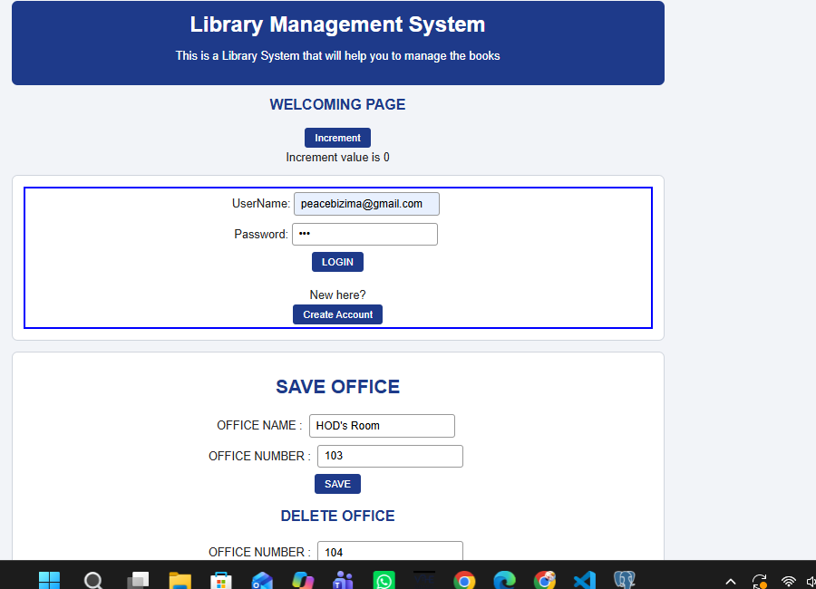
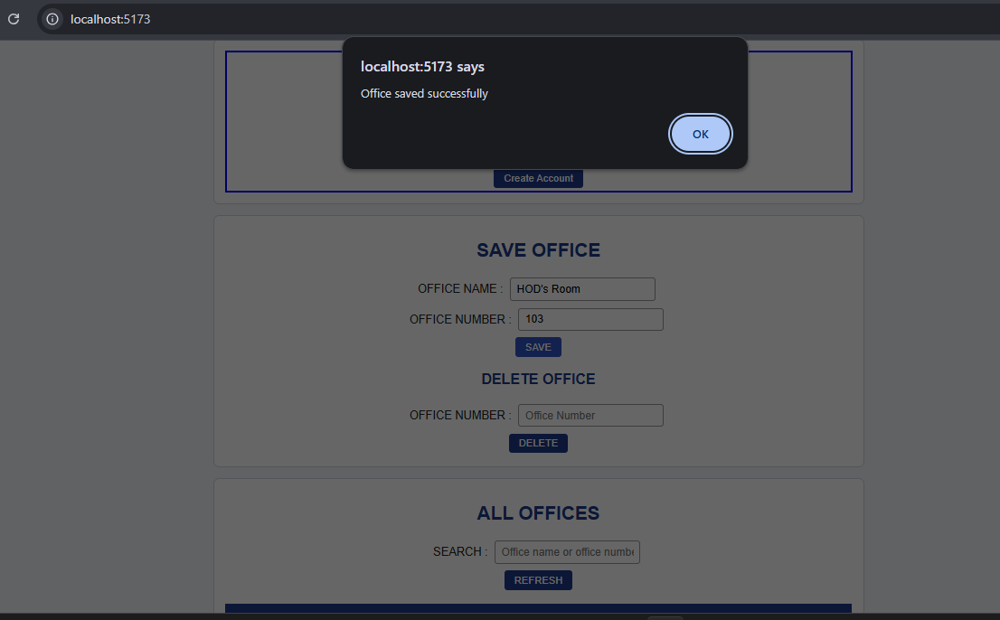
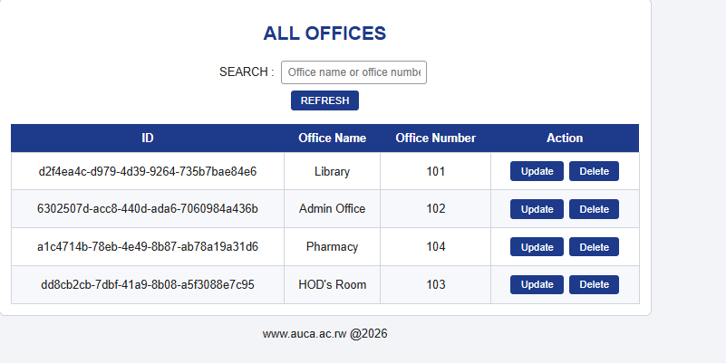
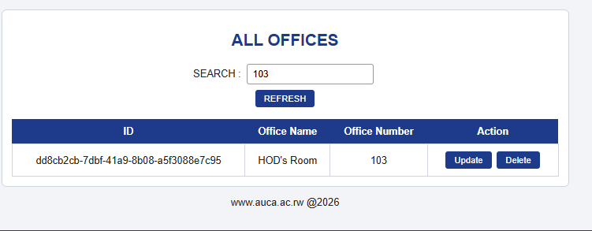
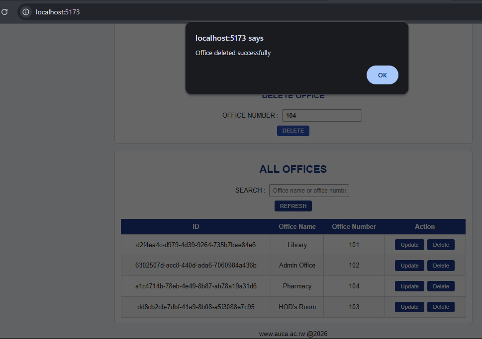

# Clinic & Library – Office Management

A full-stack web app for managing **offices**: view all offices, **search** them by name or number, **save** new ones, and **delete** existing ones.

Built as a class project with a **React** frontend and a **Spring Boot + PostgreSQL** backend.

> **Update** is planned for the next class. The Update button is already on the page but only shows a message for now.

---

## Features

| Feature | Status |
|---|---|
| List all offices in a table | Done |
| Search by office name or office number (live filtering) | Done |
| Save a new office | Done |
| Delete an office (with confirmation) | Done |
| Update an office | Coming next class |
| Friendly error when the backend is offline | Done |
| Blocks deleting an office that is assigned to a doctor | Done |

---

## Screenshots

### Home page


### Saving an office


### All offices table (with Action column)


### Searching by name or number


### Deleting an office


---

## Tech stack

**Frontend** (`library-frontend/`)
- React 19, Vite
- Axios for API calls

**Backend** (`clinicSystem/`)
- Java 24, Spring Boot 4.1.1 (Spring Web, Spring Data JPA)
- PostgreSQL

---

## Project structure

```
.
├── library-frontend/            # React app
│   └── src/
│       ├── App.jsx
│       └── component/
│           ├── Office.jsx       # save / delete by number form
│           ├── OfficeList.jsx   # offices table + search + delete
│           └── LibraryButton.jsx
├── clinicSystem/                # Spring Boot API
│   └── src/main/java/auca/example/clinicSystem/
│       ├── controller/          # REST endpoints
│       ├── services/            # business logic
│       ├── repository/          # database access
│       └── model/               # entities (Office, Doctor, ...)
└── docs/screenshots/            # images used in this README
```

---

## API (offices)

Base URL: `http://localhost:8080/api/offices`

| Method | Endpoint | Description |
|---|---|---|
| GET | `/api/offices` | Get all offices |
| GET | `/api/offices/{id}` | Get one office |
| POST | `/api/offices` | Create an office (`{ "name": "...", "officeNumber": 101 }`) |
| PUT | `/api/offices/{id}` | Update an office |
| DELETE | `/api/offices/{id}` | Delete an office (409 if assigned to a doctor) |

---

## How to run it

### Requirements
- [Node.js](https://nodejs.org) (LTS)
- JDK 24
- [PostgreSQL](https://www.postgresql.org/download/) (+ pgAdmin)

### 1. Database
1. Start the PostgreSQL service.
2. In pgAdmin, create an **empty** database named `clinic_db`.
3. Open `clinicSystem/src/main/resources/application.properties` and set your own PostgreSQL password:
   ```properties
   spring.datasource.url=jdbc:postgresql://localhost:5432/clinic_db
   spring.datasource.username=postgres
   spring.datasource.password=YOUR_PASSWORD
   ```
   Tables are created automatically on first run.

### 2. Backend
Open `clinicSystem` in IntelliJ / Eclipse / VS Code and run `ClinicSystemApplication.java`
(or from a terminal: `./mvnw spring-boot:run`, on Windows `mvnw.cmd spring-boot:run`).

Check it works: open <http://localhost:8080/api/offices>. You should see `[]`.

### 3. Frontend
```bash
cd library-frontend
npm install
npm run dev
```
Open <http://localhost:5173>.

### 4. Try it
1. In **SAVE OFFICE**, type a name and a number, then click **SAVE**.
2. In **ALL OFFICES**, click **REFRESH**.
3. Type in **SEARCH** to filter by name or number.
4. Click **Delete** on a row to remove it.

---

## Troubleshooting

| Problem | Fix |
|---|---|
| "Network Error" / red message above the table | Backend isn't running or isn't on port 8080 |
| Error 500 after starting the backend | Old tables in the database. Use a fresh empty database |
| `connection timeout` in pgAdmin | PostgreSQL service is not running (`services.msc`) |
| Saving fails | Office numbers must be unique numbers |

---

## Author

**Bpeace21** – [GitHub](https://github.com/Bpeace21)
